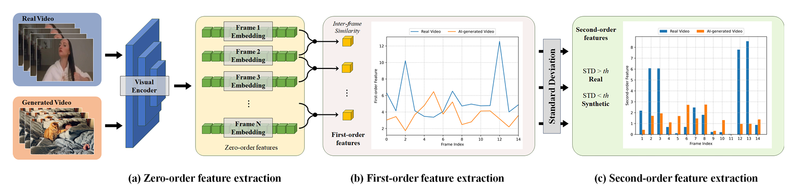

# D3 Ablation Review: Does Training-Free Video Detection Need a Pre-trained Encoder?



This repository is an ablation study of **D3**, a training-free detector for AI-generated videos, introduced in [*D3: Training-Free AI-Generated Video Detection Using Second-Order Features*](https://arxiv.org/abs/2508.00701) by Chende Zheng, Ruiqi Suo, Chenhao Lin, Zhengyu Zhao, Le Yang, Shuai Liu, Minghui Yang, Cong Wang, and Chao Shen (ICCV 2025, pp. 12852–12862). It is built on the [official D3 implementation](https://github.com/Zig-HS/D3). See [Acknowledgement](#acknowledgement).

This project was carried out by Roland Chen and Najwa Sougrati for the course CSI5241.

## About This Project

D3 encodes each video frame with a pre-trained visual encoder, then scores the video with the volatility of second-order differences between consecutive frame features. The original paper compares ten encoders and finds that GenVideo mAP stays between 94.28 and 97.72. It concludes that second-order features remain meaningful across different feature spaces. All ten of those encoders are pre-trained, so the paper does not test whether pre-training is needed at all.

**Hypothesis:** D3's detection performance does not depend on the learned, semantic content of its pre-trained encoder. Even with randomly initialized weights, D3 should retain most of its reported performance.

### Experimental Conditions

We evaluate five inference-only conditions with the paper's preprocessing (2 s, 8 fps, 224×224). We use the GenVideo-Val test split (10 generator subsets) and report per-subset AP and mAP.

| # | Condition | Role | `--encoder` |
|---|-----------|------|-------------|
| 1 | XCLIP-B/16, pre-trained | Baseline reproduction (paper: 97.72 mAP) | `XCLIP-16` |
| 2 | ResNet-18, pre-trained | Reproduction of a reported condition (paper: 96.39 mAP) | `ResNet-18` |
| 3 | ResNet-18, randomly initialized | Tests whether pre-training matters for a CNN | `ResNet-18-rand` |
| 4 | ViT-B/16, randomly initialized | Architecture-matched to (1); only the weights differ | `XCLIP-16-rand` |
| 5 | Random linear projection of downsampled frames | No network at all | `RandProj` |

Condition 4 uses the exact X-CLIP B/16 vision architecture, including its cross-frame attention, with random weights. Condition 5 average-pools each frame to 32×32 and projects it to 768 dimensions with a fixed Gaussian matrix.

### Decision Criteria

The thresholds were fixed in advance. For each randomly initialized network, they apply to the mean mAP over three random initializations.

- **Accepted** if conditions 3 and 4 both reach over 88 mAP. The pre-trained representation would then be incidental, and the second-order statistic would carry the performance.
- **Rejected** if conditions 3 and 4 both fall below 70 mAP. The representation would then be load-bearing, and the generality claimed in Section 5.1 of the paper would be narrower than stated.
- **Partial dependence** for any other outcome, including disagreement between the two architectures.

Condition 5 is read separately. If it reaches the threshold, that would show that no learned representation is required at all.

## Table of Contents
- [About This Project](#about-this-project)
- [Environment Setup](#environment-setup)
- [Dataset Preparation and Preprocessing](#dataset-preparation-and-preprocessing)
- [Inference](#inference)
- [Acknowledgement](#acknowledgement)
- [Citation](#citation)
- [License](#license)

## Environment Setup

Our codebase requires the following Python environment:

- Python >= 3.11.13

Follow these steps to set up the environment:

```bash
# Clone the repository
git clone https://github.com/Lylichen07/D3-Ablation-Review.git
cd D3-Ablation-Review

# Install required libraries
pip install -r requirements.txt
```

## Dataset Preparation and Preprocessing

This section demonstrates dataset preparation using the GenVideo dataset as an example.

### 1. Create Dataset Directory Structure

```bash
mkdir GenVideo
cd GenVideo
mkdir video csv frames
```

### 2. Download and Organize Dataset

```bash
wget https://modelscope.cn/datasets/cccnju/Gen-Video/resolve/master/GenVideo-Val.zip
unzip GenVideo-Val.zip
mv GenVideo-Val/Real video/real_MSRVTT
mv GenVideo-Val/Fake/* video/
cd ..
```

### 3. Preprocessing Steps

**Step 1: Frame Extraction**
Convert videos to frames using the video2frame utility:

```shell
python utils/video2frame.py --dataset-path GenVideo
```

**Step 2: CSV Configuration Generation**
Generate CSV configuration files for the extracted frames:

```shell
python utils/folder2csv.py --is-real True --dataset-path GenVideo --folders real_MSRVTT
python utils/folder2csv.py --is-real False --dataset-path GenVideo --folders Crafter Gen2 HotShot Lavie ModelScope MoonValley MorphStudio Show_1 Sora WildScrape
```

### Expected Dataset Structure

After proper processing, your dataset directory structure should look like this:

```
<dataset>/
├── video/
│   ├── <testsetA>/
│   │   ├── <video_id1>.mp4
│   │   ├── <video_id2>.mp4
│   │   └── ...
│   ├── <testsetB>/
│   │   ├── <video_idX>.mp4
│   │   └── ...
│   └── ... 
├── frames/
│   ├── <testsetA>/
│   │   ├── <video_id1>/
│   │   │   ├── 1.jpg
│   │   │   └── ...
│   │   └── ...
│   ├── <testsetB>/
│   │   └── ...
│   └── ... 
└── csv/
    ├── <testsetA>.csv
    ├── <testsetB>.csv
    └── ... 
```

For other datasets used in the paper (such as [EvalCrafter](https://github.com/evalcrafter/evalcrafter), [VideoPhy](https://github.com/Hritikbansal/videophy), and [VidProM](https://github.com/WangWenhao0716/VidProM)), you can download them from their official repositories and follow the same preprocessing steps described above.

## Inference

After completing dataset preprocessing, run inference using `eval.py`:

```bash
python eval.py --gpu-id 0 --loss l2 --encoder XCLIP-16 --real-csv GenVideo/csv/real_MSRVTT.csv --fake-csv GenVideo/csv/Crafter.csv
```

To run a different ablation condition, change `--encoder` to the value listed in [Experimental Conditions](#experimental-conditions).

`--seed` (default 42) sets the random weights of the randomly initialized encoders (`ResNet-18-rand`, `XCLIP-16-rand`, `RandProj`). The same seed always gives the same weights. Each of these conditions is run with three seeds, and the mean mAP is reported:

```bash
for s in 0 1 2; do
  python eval.py --gpu-id 0 --loss l2 --encoder ResNet-18-rand --seed $s --real-csv GenVideo/csv/real_MSRVTT.csv --fake-csv GenVideo/csv/Crafter.csv
done
```

Pre-trained encoders load fixed weights, so the seed does not affect them and one run is enough.

## Acknowledgement

This project is an ablation study of D3. All credit for the method, the original code, and the experimental setup we reproduce goes to its authors: Chende Zheng, Ruiqi Suo, Chenhao Lin, Zhengyu Zhao, Le Yang, Shuai Liu, Minghui Yang, Cong Wang, and Chao Shen. The code in this repository is based on their official implementation at [Zig-HS/D3](https://github.com/Zig-HS/D3). Our additions are the randomly initialized encoders and the random-projection baseline.

As noted by the original authors, parts of the video processing and dataset structure are adopted from [DeMamba](https://github.com/chenhaoxing/DeMamba).

## Citation

If you use this work, please cite the original D3 paper:

```
@article{zheng2025d3,
  title={D3: Training-Free AI-Generated Video Detection Using Second-Order Features},
  author={Zheng, Chende and Lin, Chenhao and Zhao, Zhengyu and Yang, Le and Liu, Shuai and Yang, Minghui and Wang, Cong and Shen, Chao and others},
  journal={arXiv preprint arXiv:2508.00701},
  year={2025}
}
```

## License

This project is released under the MIT License, inherited from the original [D3 repository](https://github.com/Zig-HS/D3). See [LICENSE](LICENSE) for details.
